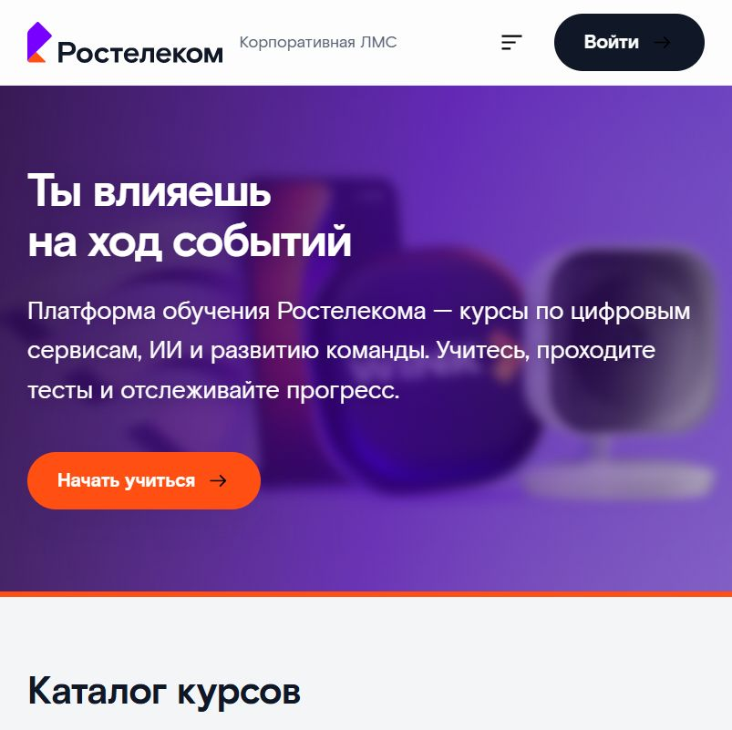

# Ростелеком ЛМС

Корпоративная платформа обучения в фирменном стиле «Ростелекома». Стек: **Python FastAPI + SQLite** (бэкенд) и **HTML/CSS/JS** (фронтенд, без сборщиков).



## Возможности

- Каталог курсов с прогрессом прохождения
- Уроки с текстовыми материалами и тестами (квизами) с автопроверкой
- Регистрация и вход по токенам с истечением (Bearer, 7 дней), роли: `student`, `teacher`, `admin`
- Полный CRUD курсов/уроков/тестов, первое назначение администратора через env при старте
- Автовыдача **сертификатов** по завершении курса с проходным баллом
- История попыток тестов, личная статистика, админ-отчёты и аудит-лог
- Rate limiting на авторизацию и API
- Личная страница результатов
- Изначально наполнено курсами по материалам «Ростелекома» (цифровые сервисы, ИИ, развитие и забота)

## Структура

```
rolstelecom-lms/
├─ app/
│  ├─ main.py        # FastAPI-приложение и API
│  ├─ db.py          # схема и подключение к SQLite
│  ├─ seed.py        # начальные данные (курсы/уроки/тесты)
│  └─ static/        # фронтенд (index.html, css, js)
├─ requirements.txt
├─ run.py            # точка запуска
├─ Dockerfile
└─ data/lms.db       # создаётся при первом запуске
```

## Запуск локально (Windows)

Требуется Python 3.10+.

```powershell
python -m venv .venv
.venv\Scripts\Activate.ps1
pip install -r requirements.txt
python run.py
```

Открыть http://127.0.0.1:8000

## Запуск через Docker

```bash
docker build -t rostelecom-lms .
docker run -p 8000:8000 -v lms-data:/srv/app/data rostelecom-lms
```

Открыть http://127.0.0.1:8000

## Учётные записи

При первом запуске БД пустая — зарегистрируйте пользователя через интерфейс (кнопка «Войти» → регистрация).

**Первый администратор** создаётся автоматически при старте из переменных окружения (если ещё не существует):

```powershell
$env:LMS_ADMIN_USERNAME = "admin"
$env:LMS_ADMIN_PASSWORD = "надёжный_пароль"
python run.py
```

ИЛИ через любой SQLite-клиент:
`UPDATE users SET role='admin' WHERE username='ваш_логин';`

## API

| Метод | Путь | Назначение |
|-------|------|-----------|
| POST | `/api/register` | регистрация |
| POST | `/api/login` | вход, выдача токена (7 дней) |
| POST | `/api/logout` | выход |
| GET  | `/api/me` | текущий пользователь |
| GET  | `/api/courses` | список курсов с прогрессом |
| POST/PUT/DELETE | `/api/courses…` | управление курсами (teacher/admin) |
| GET  | `/api/courses/{id}/lessons` | уроки курса |
| GET  | `/api/lessons/{id}` | урок с тестами (без ответов) |
| POST/PUT/DELETE | `/api/lessons…` `/api/quizzes…` | управление уроками и тестами (teacher/admin) |
| POST | `/api/lessons/{id}/complete` | отметить урок пройденным |
| POST | `/api/lessons/{id}/submit` | сдача теста (+ история, сертификат) |
| GET  | `/api/me/stats` | личная статистика |
| GET  | `/api/me/certificates` | мои сертификаты |
| GET  | `/api/me/attempts` | история моих попыток |
| GET  | `/api/admin/stats` | статистика (admin) |
| GET/PUT/DELETE | `/api/admin/users…` | управление пользователями и ролями (admin) |
| GET  | `/api/admin/reports/*`, `/api/admin/audit` | отчёты и аудит (admin) |

Все защищённые эндпоинты требуют заголовок `Authorization: Bearer <token>`.

## Тесты

```powershell
python -m unittest tests.test_api -v
```

Тесты запускаются на отдельной временной БД и не затрагивают рабочие данные.